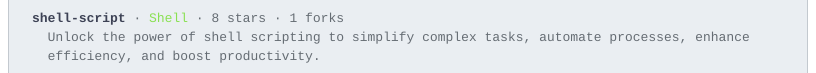
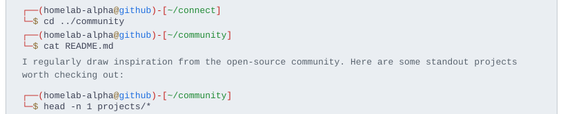
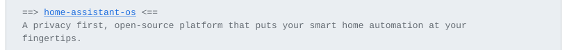
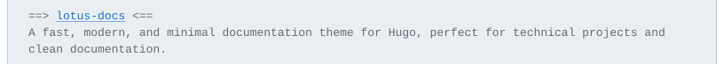
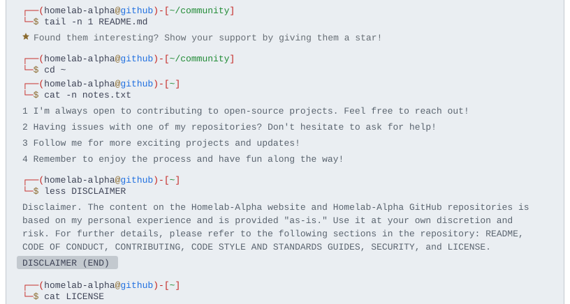
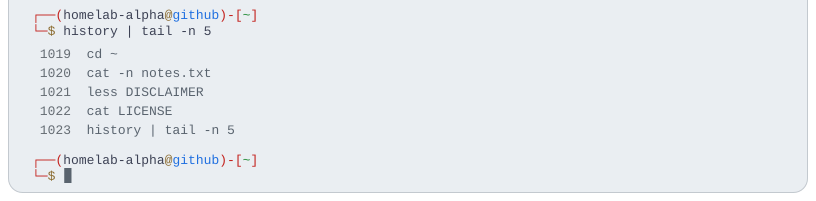

[Text version of this profile](https://github.com/homelab-alpha/homelab-alpha/blob/stats/cards/profile_text.md)

<picture><source srcset="https://raw.githubusercontent.com/homelab-alpha/homelab-alpha/stats/cards/session_1_compact_dark.svg?v=b945049e" media="(max-width: 760px) and (prefers-color-scheme: dark)"/><source srcset="https://raw.githubusercontent.com/homelab-alpha/homelab-alpha/stats/cards/session_1_compact_light.svg?v=b945049e" media="(max-width: 760px)"/><source srcset="https://raw.githubusercontent.com/homelab-alpha/homelab-alpha/stats/cards/session_1_dark.svg?v=6123db7e" media="(prefers-color-scheme: dark)"/></picture>

<a href="https://github.com/homelab-alpha/docker" target="_blank" rel="noopener noreferrer"><picture><source srcset="https://raw.githubusercontent.com/homelab-alpha/homelab-alpha/stats/cards/session_2_compact_dark.svg?v=93e9f5bb" media="(max-width: 760px) and (prefers-color-scheme: dark)"/><source srcset="https://raw.githubusercontent.com/homelab-alpha/homelab-alpha/stats/cards/session_2_compact_light.svg?v=93e9f5bb" media="(max-width: 760px)"/><source srcset="https://raw.githubusercontent.com/homelab-alpha/homelab-alpha/stats/cards/session_2_dark.svg?v=24e8e82e" media="(prefers-color-scheme: dark)"/></picture></a>

<a href="https://github.com/homelab-alpha/openssl" target="_blank" rel="noopener noreferrer"><picture><source srcset="https://raw.githubusercontent.com/homelab-alpha/homelab-alpha/stats/cards/session_3_compact_dark.svg?v=d5179e8c" media="(max-width: 760px) and (prefers-color-scheme: dark)"/><source srcset="https://raw.githubusercontent.com/homelab-alpha/homelab-alpha/stats/cards/session_3_compact_light.svg?v=d5179e8c" media="(max-width: 760px)"/><source srcset="https://raw.githubusercontent.com/homelab-alpha/homelab-alpha/stats/cards/session_3_dark.svg?v=52bab660" media="(prefers-color-scheme: dark)"/></picture></a>

<a href="https://github.com/homelab-alpha/shell-script" target="_blank" rel="noopener noreferrer"><picture><source srcset="https://raw.githubusercontent.com/homelab-alpha/homelab-alpha/stats/cards/session_4_compact_dark.svg?v=eae77181" media="(max-width: 760px) and (prefers-color-scheme: dark)"/><source srcset="https://raw.githubusercontent.com/homelab-alpha/homelab-alpha/stats/cards/session_4_compact_light.svg?v=eae77181" media="(max-width: 760px)"/><source srcset="https://raw.githubusercontent.com/homelab-alpha/homelab-alpha/stats/cards/session_4_dark.svg?v=e862ecb6" media="(prefers-color-scheme: dark)"/></picture></a>

<a href="https://github.com/homelab-alpha/kairos" target="_blank" rel="noopener noreferrer"><picture><source srcset="https://raw.githubusercontent.com/homelab-alpha/homelab-alpha/stats/cards/session_5_compact_dark.svg?v=e17bb9ff" media="(max-width: 760px) and (prefers-color-scheme: dark)"/><source srcset="https://raw.githubusercontent.com/homelab-alpha/homelab-alpha/stats/cards/session_5_compact_light.svg?v=e17bb9ff" media="(max-width: 760px)"/><source srcset="https://raw.githubusercontent.com/homelab-alpha/homelab-alpha/stats/cards/session_5_dark.svg?v=907ca8fa" media="(prefers-color-scheme: dark)"/></picture></a>

<picture><source srcset="https://raw.githubusercontent.com/homelab-alpha/homelab-alpha/stats/cards/session_6_compact_dark.svg?v=bd1e203a" media="(max-width: 760px) and (prefers-color-scheme: dark)"/><source srcset="https://raw.githubusercontent.com/homelab-alpha/homelab-alpha/stats/cards/session_6_compact_light.svg?v=bd1e203a" media="(max-width: 760px)"/><source srcset="https://raw.githubusercontent.com/homelab-alpha/homelab-alpha/stats/cards/session_6_dark.svg?v=b9b304b0" media="(prefers-color-scheme: dark)"/></picture>

<a href="https://gist.github.com/homelab-alpha/e0f265a9c9b20ca786bce2327ce87060" target="_blank" rel="noopener noreferrer"><picture><source srcset="https://raw.githubusercontent.com/homelab-alpha/homelab-alpha/stats/cards/session_7_compact_dark.svg?v=2170462f" media="(max-width: 760px) and (prefers-color-scheme: dark)"/><source srcset="https://raw.githubusercontent.com/homelab-alpha/homelab-alpha/stats/cards/session_7_compact_light.svg?v=2170462f" media="(max-width: 760px)"/><source srcset="https://raw.githubusercontent.com/homelab-alpha/homelab-alpha/stats/cards/session_7_dark.svg?v=d6b44af5" media="(prefers-color-scheme: dark)"/></picture></a>

<a href="https://gist.github.com/homelab-alpha/1be7e1f886d063c60493f1cf216c87fc" target="_blank" rel="noopener noreferrer"><picture><source srcset="https://raw.githubusercontent.com/homelab-alpha/homelab-alpha/stats/cards/session_8_compact_dark.svg?v=10975e97" media="(max-width: 760px) and (prefers-color-scheme: dark)"/><source srcset="https://raw.githubusercontent.com/homelab-alpha/homelab-alpha/stats/cards/session_8_compact_light.svg?v=c1c842e1" media="(max-width: 760px)"/><source srcset="https://raw.githubusercontent.com/homelab-alpha/homelab-alpha/stats/cards/session_8_dark.svg?v=313542fa" media="(prefers-color-scheme: dark)"/></picture></a>

<picture><source srcset="https://raw.githubusercontent.com/homelab-alpha/homelab-alpha/stats/cards/session_9_compact_dark.svg?v=df4912c6" media="(max-width: 760px) and (prefers-color-scheme: dark)"/><source srcset="https://raw.githubusercontent.com/homelab-alpha/homelab-alpha/stats/cards/session_9_compact_light.svg?v=4c23c4bf" media="(max-width: 760px)"/><source srcset="https://raw.githubusercontent.com/homelab-alpha/homelab-alpha/stats/cards/session_9_dark.svg?v=deedd370" media="(prefers-color-scheme: dark)"/></picture>

<a href="https://github.com/homelab-alpha?tab=repositories&amp;q=&amp;type=&amp;language=&amp;sort=stargazers" target="_blank" rel="noopener noreferrer"><picture><source srcset="https://raw.githubusercontent.com/homelab-alpha/homelab-alpha/stats/cards/session_10_compact_dark.svg?v=77612aad" media="(max-width: 760px) and (prefers-color-scheme: dark)"/><source srcset="https://raw.githubusercontent.com/homelab-alpha/homelab-alpha/stats/cards/session_10_compact_light.svg?v=30c11a0a" media="(max-width: 760px)"/><source srcset="https://raw.githubusercontent.com/homelab-alpha/homelab-alpha/stats/cards/session_10_dark.svg?v=55ec36ff" media="(prefers-color-scheme: dark)"/></picture></a>

<a href="https://homelab-alpha.nl/docs" target="_blank" rel="noopener noreferrer"><picture><source srcset="https://raw.githubusercontent.com/homelab-alpha/homelab-alpha/stats/cards/session_11_compact_dark.svg?v=02f7429c" media="(max-width: 760px) and (prefers-color-scheme: dark)"/><source srcset="https://raw.githubusercontent.com/homelab-alpha/homelab-alpha/stats/cards/session_11_compact_light.svg?v=9149c5c6" media="(max-width: 760px)"/><source srcset="https://raw.githubusercontent.com/homelab-alpha/homelab-alpha/stats/cards/session_11_dark.svg?v=6db29874" media="(prefers-color-scheme: dark)"/></picture></a>

<a href="https://gist.github.com/homelab-alpha" target="_blank" rel="noopener noreferrer"><picture><source srcset="https://raw.githubusercontent.com/homelab-alpha/homelab-alpha/stats/cards/session_12_compact_dark.svg?v=a4784b44" media="(max-width: 760px) and (prefers-color-scheme: dark)"/><source srcset="https://raw.githubusercontent.com/homelab-alpha/homelab-alpha/stats/cards/session_12_compact_light.svg?v=5c28c2ee" media="(max-width: 760px)"/><source srcset="https://raw.githubusercontent.com/homelab-alpha/homelab-alpha/stats/cards/session_12_dark.svg?v=572cf541" media="(prefers-color-scheme: dark)"/></picture></a>

<picture><source srcset="https://raw.githubusercontent.com/homelab-alpha/homelab-alpha/stats/cards/session_13_compact_dark.svg?v=5123bc19" media="(max-width: 760px) and (prefers-color-scheme: dark)"/><source srcset="https://raw.githubusercontent.com/homelab-alpha/homelab-alpha/stats/cards/session_13_compact_light.svg?v=de396d1f" media="(max-width: 760px)"/><source srcset="https://raw.githubusercontent.com/homelab-alpha/homelab-alpha/stats/cards/session_13_dark.svg?v=8ebdc494" media="(prefers-color-scheme: dark)"/></picture>

<a href="https://github.com/AdguardTeam/AdGuardHome" target="_blank" rel="noopener noreferrer"><picture><source srcset="https://raw.githubusercontent.com/homelab-alpha/homelab-alpha/stats/cards/session_14_compact_dark.svg?v=68ef7850" media="(max-width: 760px) and (prefers-color-scheme: dark)"/><source srcset="https://raw.githubusercontent.com/homelab-alpha/homelab-alpha/stats/cards/session_14_compact_light.svg?v=d545c608" media="(max-width: 760px)"/><source srcset="https://raw.githubusercontent.com/homelab-alpha/homelab-alpha/stats/cards/session_14_dark.svg?v=10c1a3bb" media="(prefers-color-scheme: dark)"/></picture></a>

<a href="https://github.com/amir20/dozzle" target="_blank" rel="noopener noreferrer"><picture><source srcset="https://raw.githubusercontent.com/homelab-alpha/homelab-alpha/stats/cards/session_15_compact_dark.svg?v=35f1caad" media="(max-width: 760px) and (prefers-color-scheme: dark)"/><source srcset="https://raw.githubusercontent.com/homelab-alpha/homelab-alpha/stats/cards/session_15_compact_light.svg?v=41190254" media="(max-width: 760px)"/><source srcset="https://raw.githubusercontent.com/homelab-alpha/homelab-alpha/stats/cards/session_15_dark.svg?v=e2a6f6ea" media="(prefers-color-scheme: dark)"/></picture></a>

<a href="https://github.com/FreshRSS/FreshRSS" target="_blank" rel="noopener noreferrer"><picture><source srcset="https://raw.githubusercontent.com/homelab-alpha/homelab-alpha/stats/cards/session_16_compact_dark.svg?v=d2d6dd60" media="(max-width: 760px) and (prefers-color-scheme: dark)"/><source srcset="https://raw.githubusercontent.com/homelab-alpha/homelab-alpha/stats/cards/session_16_compact_light.svg?v=622fd115" media="(max-width: 760px)"/><source srcset="https://raw.githubusercontent.com/homelab-alpha/homelab-alpha/stats/cards/session_16_dark.svg?v=69bbc7a0" media="(prefers-color-scheme: dark)"/></picture></a>

<a href="https://github.com/home-assistant/operating-system" target="_blank" rel="noopener noreferrer"><picture><source srcset="https://raw.githubusercontent.com/homelab-alpha/homelab-alpha/stats/cards/session_17_compact_dark.svg?v=7d8c515e" media="(max-width: 760px) and (prefers-color-scheme: dark)"/><source srcset="https://raw.githubusercontent.com/homelab-alpha/homelab-alpha/stats/cards/session_17_compact_light.svg?v=15bd5da4" media="(max-width: 760px)"/><source srcset="https://raw.githubusercontent.com/homelab-alpha/homelab-alpha/stats/cards/session_17_dark.svg?v=973ef91e" media="(prefers-color-scheme: dark)"/></picture></a>

<a href="https://github.com/colinwilson/lotusdocs" target="_blank" rel="noopener noreferrer"><picture><source srcset="https://raw.githubusercontent.com/homelab-alpha/homelab-alpha/stats/cards/session_18_compact_dark.svg?v=2b2dd0d2" media="(max-width: 760px) and (prefers-color-scheme: dark)"/><source srcset="https://raw.githubusercontent.com/homelab-alpha/homelab-alpha/stats/cards/session_18_compact_light.svg?v=f3d8b45d" media="(max-width: 760px)"/><source srcset="https://raw.githubusercontent.com/homelab-alpha/homelab-alpha/stats/cards/session_18_dark.svg?v=a266d4e0" media="(prefers-color-scheme: dark)"/></picture></a>

<a href="https://github.com/alexjustesen/speedtest-tracker" target="_blank" rel="noopener noreferrer"><picture><source srcset="https://raw.githubusercontent.com/homelab-alpha/homelab-alpha/stats/cards/session_19_compact_dark.svg?v=6727d474" media="(max-width: 760px) and (prefers-color-scheme: dark)"/><source srcset="https://raw.githubusercontent.com/homelab-alpha/homelab-alpha/stats/cards/session_19_compact_light.svg?v=be78ca29" media="(max-width: 760px)"/><source srcset="https://raw.githubusercontent.com/homelab-alpha/homelab-alpha/stats/cards/session_19_dark.svg?v=9fd5f416" media="(prefers-color-scheme: dark)"/></picture></a>

<picture><source srcset="https://raw.githubusercontent.com/homelab-alpha/homelab-alpha/stats/cards/session_20_compact_dark.svg?v=53cb2ace" media="(max-width: 760px) and (prefers-color-scheme: dark)"/><source srcset="https://raw.githubusercontent.com/homelab-alpha/homelab-alpha/stats/cards/session_20_compact_light.svg?v=5aa1e9d2" media="(max-width: 760px)"/><source srcset="https://raw.githubusercontent.com/homelab-alpha/homelab-alpha/stats/cards/session_20_dark.svg?v=735f6a48" media="(prefers-color-scheme: dark)"/></picture>

<a href="https://homelab-alpha.nl" target="_blank" rel="noopener noreferrer" aria-label="Go to the Homelab-Alpha homepage"><picture><source srcset="https://raw.githubusercontent.com/homelab-alpha/homelab-alpha/stats/cards/session_21_1_compact_dark.svg?v=3cf82c21" media="(max-width: 760px) and (prefers-color-scheme: dark)"/><source srcset="https://raw.githubusercontent.com/homelab-alpha/homelab-alpha/stats/cards/session_21_1_compact_light.svg?v=88713d60" media="(max-width: 760px)"/><source srcset="https://raw.githubusercontent.com/homelab-alpha/homelab-alpha/stats/cards/session_21_1_dark.svg?v=d6ec8486" media="(prefers-color-scheme: dark)"/></picture></a><a href="https://github.com/homelab-alpha" target="_blank" rel="noopener noreferrer" aria-label="Visit the Homelab-Alpha GitHub page"><picture><source srcset="https://raw.githubusercontent.com/homelab-alpha/homelab-alpha/stats/cards/session_21_2_compact_dark.svg?v=cc1f8277" media="(max-width: 760px) and (prefers-color-scheme: dark)"/><source srcset="https://raw.githubusercontent.com/homelab-alpha/homelab-alpha/stats/cards/session_21_2_compact_light.svg?v=707c5ef9" media="(max-width: 760px)"/><source srcset="https://raw.githubusercontent.com/homelab-alpha/homelab-alpha/stats/cards/session_21_2_dark.svg?v=8bf9cf47" media="(prefers-color-scheme: dark)"/></picture></a><a href="https://creativecommons.org/licenses/by-nc-sa/4.0/" target="_blank" rel="noopener noreferrer" aria-label="Read more about the CC BY-NC-SA 4.0 license"><picture><source srcset="https://raw.githubusercontent.com/homelab-alpha/homelab-alpha/stats/cards/session_21_3_compact_dark.svg?v=edeba4d0" media="(max-width: 760px) and (prefers-color-scheme: dark)"/><source srcset="https://raw.githubusercontent.com/homelab-alpha/homelab-alpha/stats/cards/session_21_3_compact_light.svg?v=841133ee" media="(max-width: 760px)"/><source srcset="https://raw.githubusercontent.com/homelab-alpha/homelab-alpha/stats/cards/session_21_3_dark.svg?v=f14ed264" media="(prefers-color-scheme: dark)"/></picture></a>

<picture><source srcset="https://raw.githubusercontent.com/homelab-alpha/homelab-alpha/stats/cards/session_22_compact_dark.svg?v=c1ecd0de" media="(max-width: 760px) and (prefers-color-scheme: dark)"/><source srcset="https://raw.githubusercontent.com/homelab-alpha/homelab-alpha/stats/cards/session_22_compact_light.svg?v=55fe55ba" media="(max-width: 760px)"/><source srcset="https://raw.githubusercontent.com/homelab-alpha/homelab-alpha/stats/cards/session_22_dark.svg?v=5a627c9e" media="(prefers-color-scheme: dark)"/></picture>

